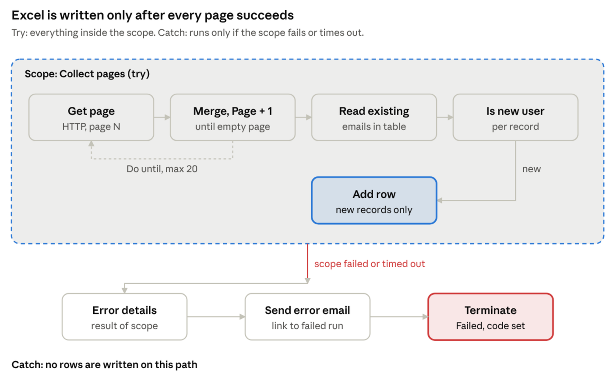
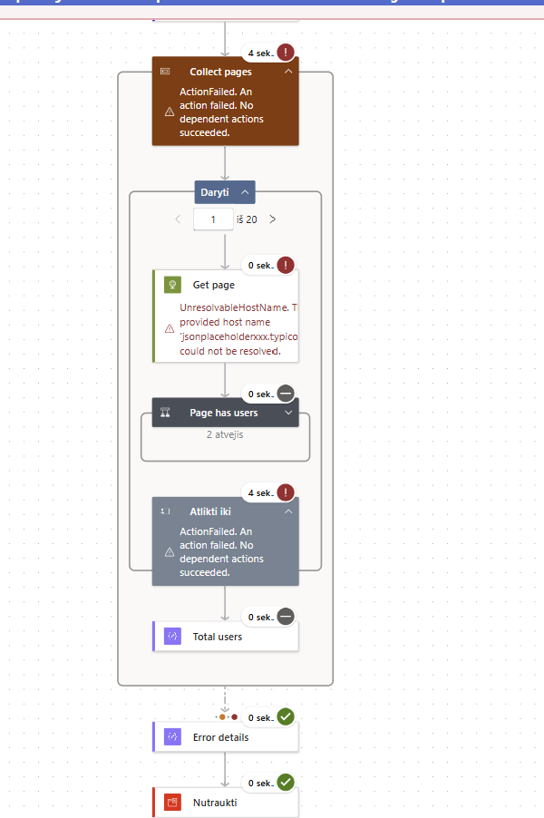
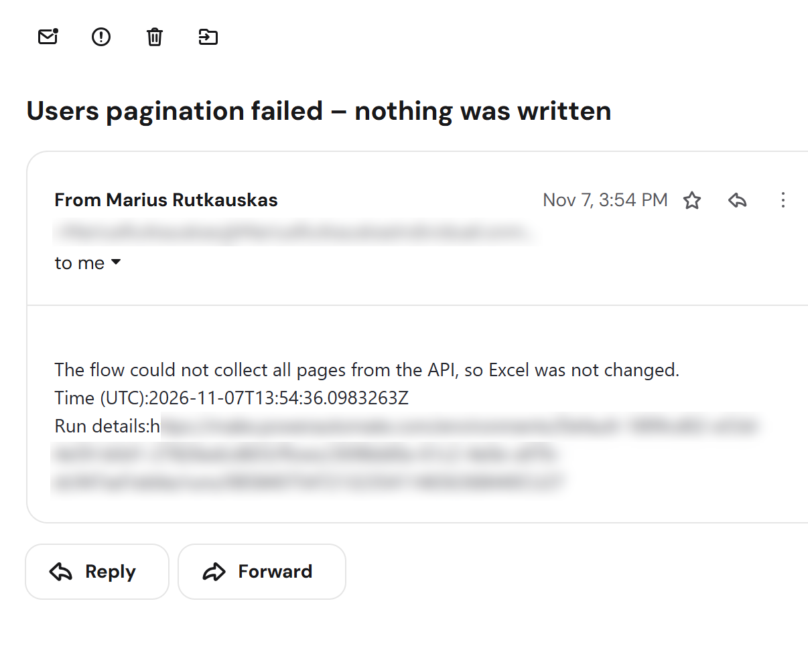
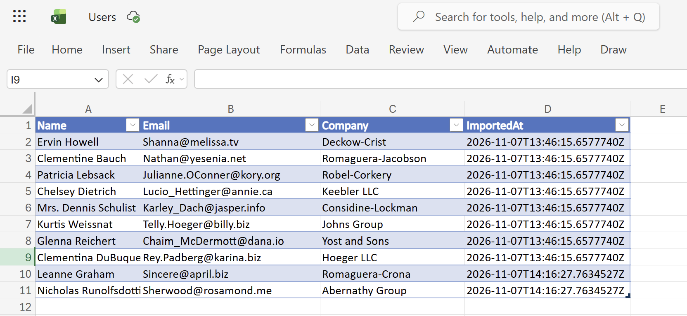

# API to Excel sync with pagination and error alerts (Power Automate)

A Power Automate cloud flow that pulls every record from a paginated REST API into an Excel Online table. Excel is changed only after all pages have been collected; if anything fails, nothing is written and an alert email goes out.

Tested with a public test API ([JSONPlaceholder](https://jsonplaceholder.typicode.com/)) and fictional data.

## What it does

- **Pagination:** requests page after page until the API returns an empty one. A hard iteration limit stops a misbehaving API from keeping the flow running.
- **All or nothing:** all collecting and writing sits inside one scope (try/catch). A failure anywhere skips the writes, so the table never holds half a dataset.
- **Alert on failure:** an email with the time and a direct link to the failed run, then the run ends as **Failed** with a clear error code, so it doesn't appear as a success in the run history.
- **No duplicates:** existing rows are read once per run. A record is added only if its email isn't in the table yet, compared in lower case.
- **One timestamp per run:** every row from the same run shares one import time.

| Failed run | Alert email |
| --- | --- |
|  |  |

## Test results

| Scenario | Result |
| --- | --- |
| Normal run, empty table | 10 rows written, one shared timestamp |
| API unreachable | Scope failed, no rows written, alert received, run marked Failed |
| Re-run with all records present | 0 new rows |
| Re-run with 2 records deleted | Only those 2 added back, with the new run's timestamp |

## Lessons learned

| Finding | Why it matters | What I did |
| --- | --- | --- |
| A Do until loop doesn't stop when an action inside it fails | In the failure test the loop ran to its limit because the exit flag was never set | Kept a low iteration limit as a safety net; the scope still blocks the write |
| A variable can't be set from its own value | `AllUsers = AllUsers + page` is rejected | Merge in a separate action first, then store the result |
| `utcNow()` inside a loop gives a different time per row | One import showed 10 different timestamps | Take the time once before the loop and reuse it |
| A handled failure counts as a successful run | The history would look green after an error | End the error path with Terminate (Failed) |
| A plain URL in the alert wasn't clickable | The link was sent as text | Build an HTML link to the failed run |

## Built with

Power Automate cloud flows (HTTP, Parse JSON, variables, Do until, Scope, Configure run after, Terminate), Excel Online (Business), Office 365 Outlook.
